<p align="center">
  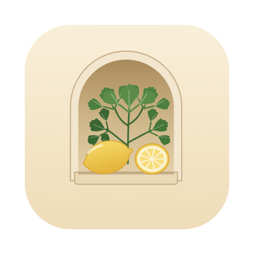
</p>

<h1 align="center">Nookery</h1>

<p align="center"><strong>Your kitchen, kept kindly.</strong><br>
Know what you have, what to eat first, and what to cook tonight, without sending a thing to anyone.</p>

<p align="center">
  <picture>
    <source media="(prefers-color-scheme: dark)" srcset="docs/media/kitchen-dark.png">
    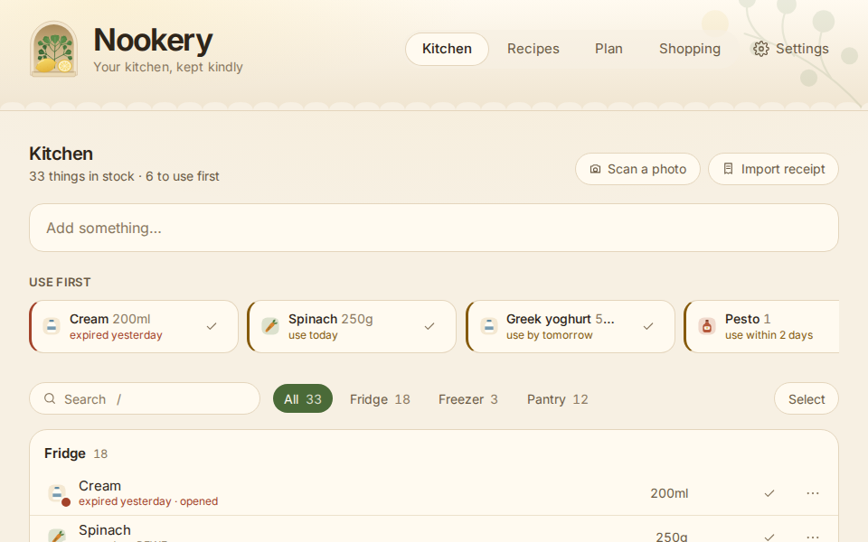
  </picture>
</p>

You come home with shopping. A few days later you stand in front of the fridge and wonder what happened to the spinach, whether the yoghurt is still good, and what on earth you could make with half a block of halloumi.

Nookery is a quiet little helper for exactly that moment. It keeps track of what is in your kitchen, nudges you toward the things that need eating first, and suggests meals from what you actually have. It lives on your own Mac and phone. There is no account, no subscription and no company holding your shopping habits.

> **A note on the pictures below.** Every animation in this page is recorded from the app running on made-up sample food, never someone's real kitchen. They are re-recorded automatically whenever the app changes, so they show the app as it is today.

## What it does for you

Here is an ordinary day with Nookery.

### 1. You put the shopping away

Type what you bought and press Add. It lands in the fridge, freezer or pantry, with an amount and a best-before date if you have one. You can also bring in a receipt (a photo of the paper one, the PDF from the shop's app, or pasted text) and Nookery reads the lines for you. Photos are read on your Mac, and you check the amounts before anything is added. And if you would rather not type at all, take a photo of your fridge and let it work out what is in there.

When something is used up or thrown away, one tap removes it, and for a few seconds there is an **Undo** in case your finger slipped.

<p align="center">
  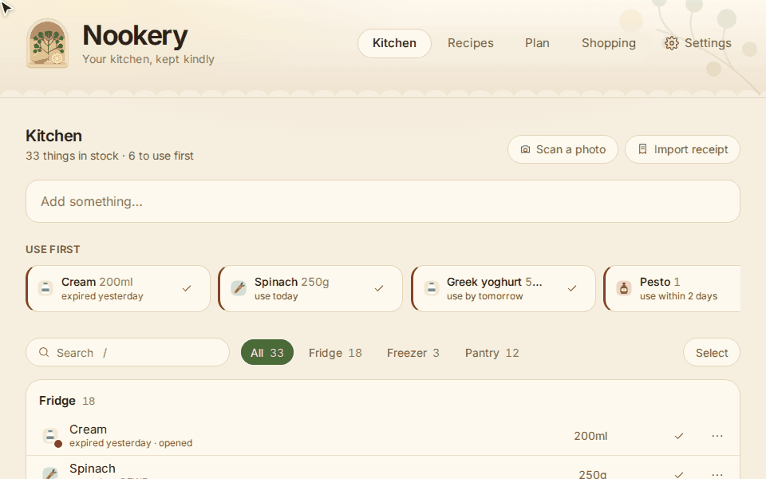
</p>

### 2. You see what to use first

The top of the Kitchen is a short row called **Use first**: things past their date, and things that will be soon. Red means it is already past its date. Amber means use it in the next day or two. The rest of the list is sorted so you can see where everything is. Nothing is a surprise at the back of the fridge.

### 3. You scan a photo instead of typing

Open **Scan a photo**, say where it was taken (fridge, freezer or pantry), choose the picture and press Scan. Nookery looks at it in small pieces, so it does not skim over the back of the shelf.

Then you decide. Things it already knew about are marked **Seen**. Things it has not met before appear under **New?** and are only added if you say so. Things that are not in the photo are listed under **Not in the photo**, but they are never removed on a guess. You choose *Used up* or *Still there*.

<p align="center">
  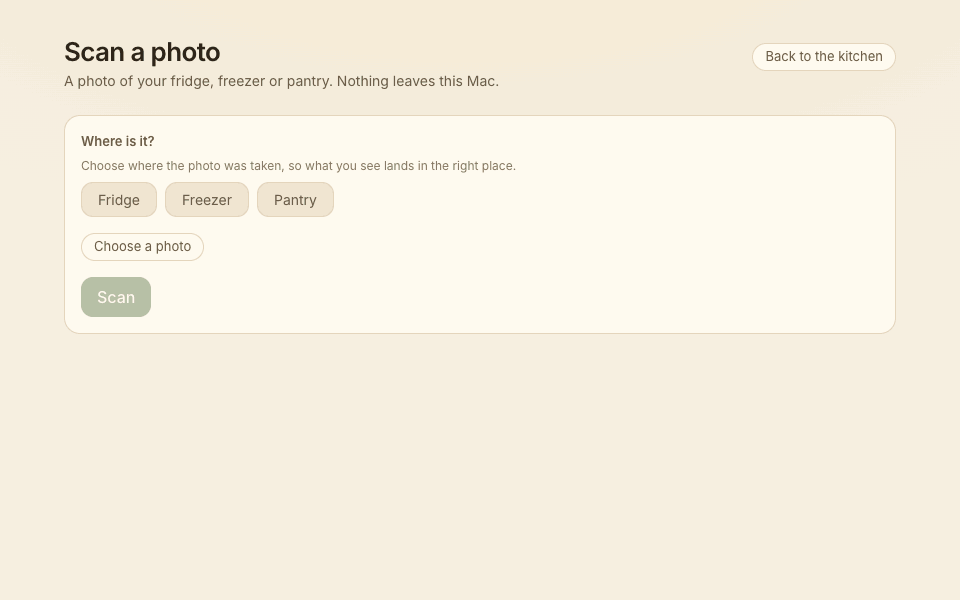
</p>

### 4. You find something to cook

Open **Recipes**, pick the mood (*Use it up*, *Quick weeknight*, *High protein*, *Vegetarian*, *Something new*, or add your own), add a note like "no chilli", and press Suggest. A few moments later you get ideas, each with its own little illustration, and an honest list: what you **have**, what you would **need**, and a warning if something has already expired.

Open one and the full recipe is written out for you. Underneath, you can talk to it like a friend in the kitchen: ask "Can I freeze the leftovers?" or "What can I use instead of halloumi?", or say "make it vegetarian", "no oven" or "for 4 people", and the recipe above updates itself (with an **Undo change** if you liked it better before). Keep the ones you love with the heart, and when you have cooked, press **I cooked it** and tell Nookery how much of each thing you used, so your list stays right.

<p align="center">
  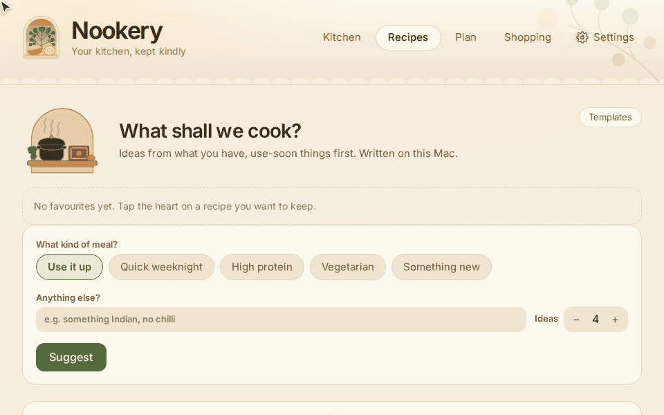
</p>

### 5. You plan the week

**Plan** makes a week of dinners that uses up what needs eating first and keeps the week varied (for example a vegetable in at least half of the dinners, and no more than two with the same main protein). Not keen on Wednesday? Swap it. Cooked one? Tick it off.

When you like the week, **Add what's missing to the shopping list** puts the missing ingredients on your list.

<p align="center">
  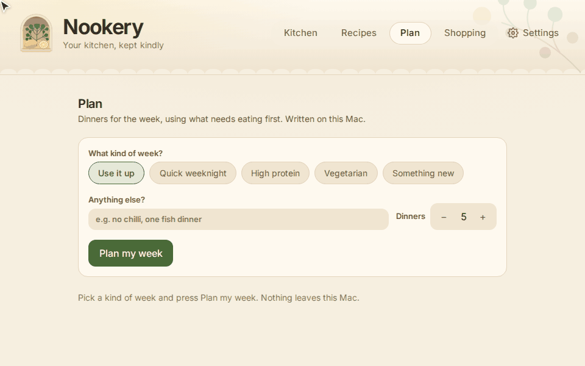
</p>

### 6. You shop with the list on your phone

The shopping list is grouped by aisle. Tick things as they go in the basket. When you are home, **Put away** moves the ticked items into your kitchen (chilled things to the fridge, the rest to the pantry), with an Undo if that was not what you meant.

<p align="center">
  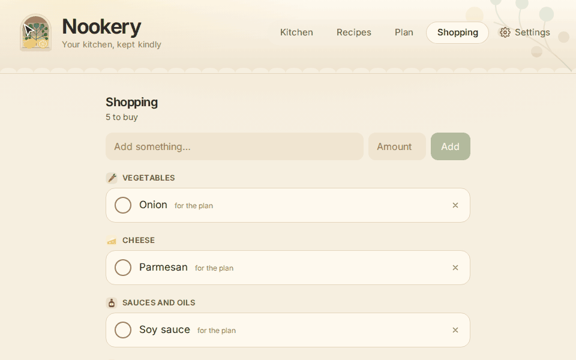
</p>

The same app runs on your Android phone, with a tab bar along the bottom, so the kitchen, the recipes and the shopping list are always in your pocket.

<p align="center">
  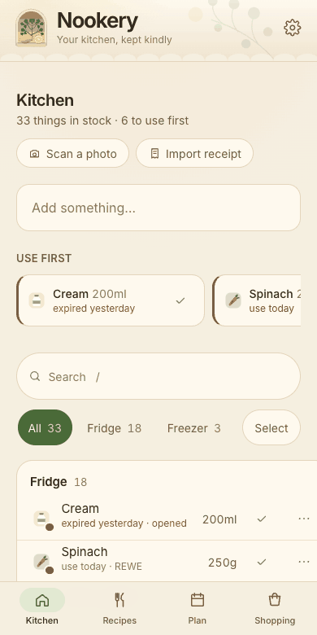
</p>

### 7. Your phone and your Mac stay in step

At home, the phone and the Mac keep each other up to date over your own Wi-Fi: your kitchen list, favourites, plans and shopping list. Nothing goes through the internet. To connect them once, open **Settings** on the Mac and switch on **Share with my phone**. It shows a QR code (and a short code and address, if you would rather type them).

<p align="center">
  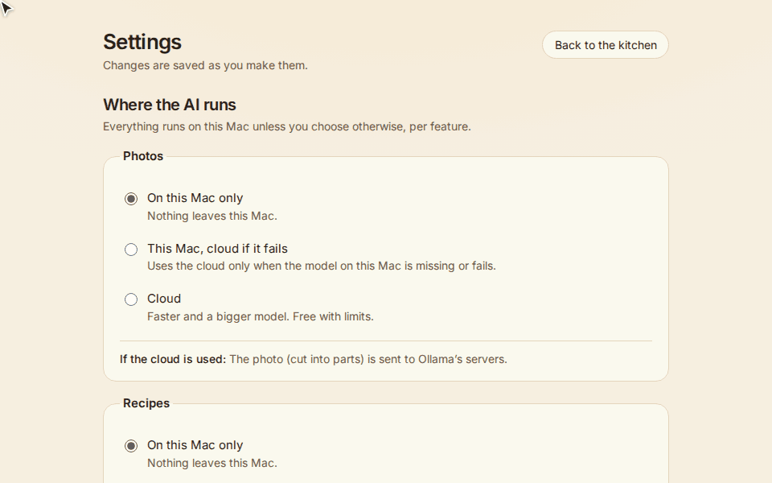
</p>

Then on the phone, open **Settings** and scan the QR code. You are paired.

<p align="center">
  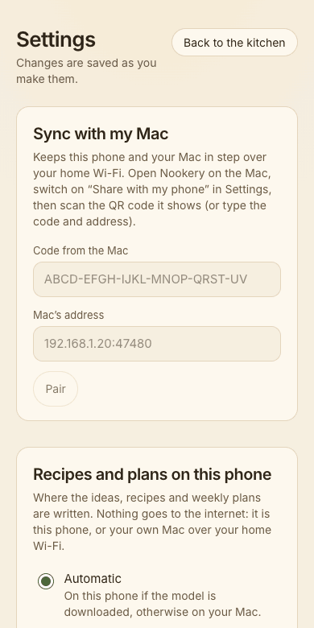
</p>

## Your kitchen stays yours

Your kitchen is personal, so Nookery is built to keep it that way.

- **It lives on your devices.** Your list is one file on your Mac, and a copy on your phone. No account, no sign-up.
- **The thinking happens on your own computer too.** Reading photos and writing recipes is done by an AI model that runs on your Mac through [Ollama](https://ollama.com). The phone can write recipes on the phone itself, once you have downloaded a small model from your Mac over your home Wi-Fi.
- **The cloud is something you choose, never a default.** In **Settings**, for photos and for recipes separately, you pick *On this Mac only*, *This Mac, cloud if it fails*, or *Cloud*. Settings says plainly what would be sent. Whenever an answer did come from the cloud, Nookery tells you right there on screen.
- **Nothing is deleted on a guess.** If something has not been confirmed for a while, it is marked as "probably used up" and Nookery asks. A photo that does not show the cheese does not make the cheese vanish. Every removal has an Undo.

<p align="center">
  <picture>
    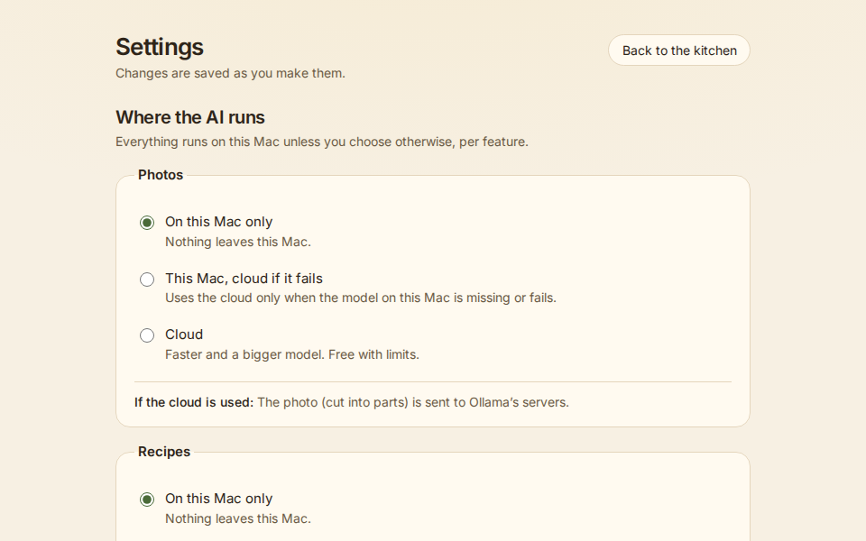
  </picture>
</p>

## Getting started

Nookery is early, and honest about it. There is no app store version and no ready-made download yet, so the first set-up takes about half an hour and a bit of Terminal. After that it is just an app.

### On your Mac

1. **Install Ollama.** It is the free app that runs the AI model on your Mac. Get it from [ollama.com](https://ollama.com) and open it once.
2. **Download the model.** In Terminal, run this once. It is a few gigabytes, so it takes a while:
   ```sh
   ollama pull qwen3-vl:8b-instruct
   ```
3. **Get Nookery.** You will need [Rust](https://rustup.rs), [Node.js](https://nodejs.org) and [pnpm](https://pnpm.io). Then:
   ```sh
   git clone https://github.com/scaling-physics/nookery.git
   cd nookery
   pnpm -C ui install
   pnpm tauri build --bundles app
   ```
4. **Move it into Applications.**
   ```sh
   ditto target/release/bundle/macos/Nookery.app /Applications/Nookery.app
   ```
   The app is not signed, so the first time, right-click it and choose **Open**.
5. **Look around.** The kitchen starts empty. Add something, or open **Import receipt** or **Scan a photo**.

### On your phone (Android)

The Android app is brand new. It works, but you build it yourself for now (`scripts/android.sh` in this repo does the heavy lifting) and it has so far been tried on an emulator, not yet on a real phone. If you want to try it, pair it as described above: on the Mac, **Settings, Share with my phone**, and on the phone, **Settings, scan the QR code**.

To get recipes on the phone without the Mac, open **Settings** on the phone and download the small recipe model from your Mac (the Mac needs `ollama pull qwen3:4b-instruct` first).

### Still early

- **Receipt photos need your Mac.** Paper receipts are read by your Mac's built-in text recognition (on the phone, the photo is sent to your Mac over your home Wi-Fi). PDFs and text work anywhere. Reading is new and has only been tried on sample receipts so far, so check the amounts: the lines must add up to the receipt's total before you can import.
- **Photo scanning runs on the Mac.** Fridge and pantry photos are read by the Mac's model. From the phone, the photo is sent to your Mac over your home Wi-Fi, so it only works when the Mac is on, at home and has Nookery open.
- **The Android app is new.** Expect rough edges.
- **No barcode scanning yet.** It is on the list.

## Questions you might have

**Does it need the internet?**
Not to work. Your kitchen, receipts, photos and recipes all work offline, as long as Ollama is running on your Mac. You need the internet once to download Ollama and the model, and only after that if you choose to use the cloud.

**What does the AI see?**
Only what you give it. For a photo scan, that is the picture you pick, cut into small parts. For recipes, it is the list of what you have (names, amounts, dates) and the note you typed. On your Mac this never leaves the computer. If you switch a feature to the cloud, Settings spells out what would be sent, and the app tells you whenever the cloud answered.

**What if it guesses wrong?**
Nothing happens without you. Photo guesses are only suggestions: new items are added only if you press Add, and missing items are only removed if you say they are used up. Anything you remove can be undone for a few seconds, and Nookery remembers your corrections (a name you changed for a receipt line or a photo is learned for next time).

**Which shops does it read?**
Receipts from **REWE, EDEKA, Netto and denn's Biomarkt** (German receipts) are read today. Receipts from other shops might work, because most receipts look alike, but they are not tested.

**Can I use it on my own food?**
That is the point. If you want to see it without any of your own data, the pictures above show exactly that on sample food.

---

## For contributors

Nookery is a Rust workspace (`crates/`: the ledger, the store, receipts, photos, recipes, planning, sync and the phone model) with a Tauri 2 shell (`src-tauri/`) and a SvelteKit UI (`ui/`). **[`AGENTS.md`](AGENTS.md)** is the full guide: how it is built, the principles to keep, and every command.

```sh
cargo fmt --all && cargo clippy --workspace --all-targets && cargo test --workspace
pnpm -C ui check && pnpm -C ui test
NOOKERY_DATA_DIR=$(mktemp -d) pnpm tauri dev   # never touch your real kitchen while developing
```

**The README pictures** are recorded from the UI running on its built-in sample data (`pnpm -C ui dev`, in a plain browser). To refresh them:

```sh
pnpm -C ui install
pnpm -C ui exec playwright install chromium   # once
pnpm readme:media
```

That writes the GIFs and screenshots to `docs/media/`. The script is `scripts/readme-media/capture.mjs`. On every push, the *README media* GitHub Action runs it and commits the result back when the screens changed (skipped when nothing the pictures depend on changed). Do not edit `docs/media/` by hand.

## License

[Apache License 2.0](LICENSE).
